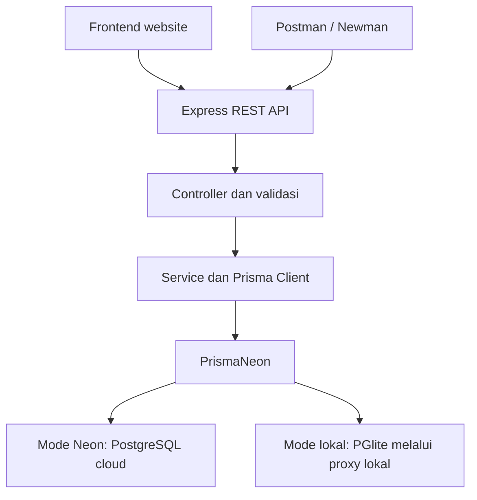
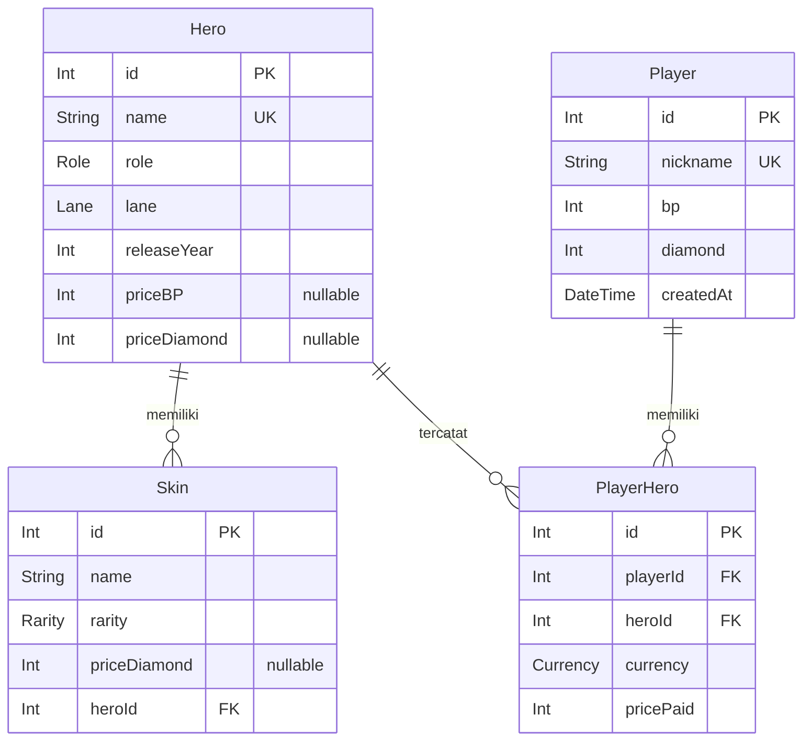
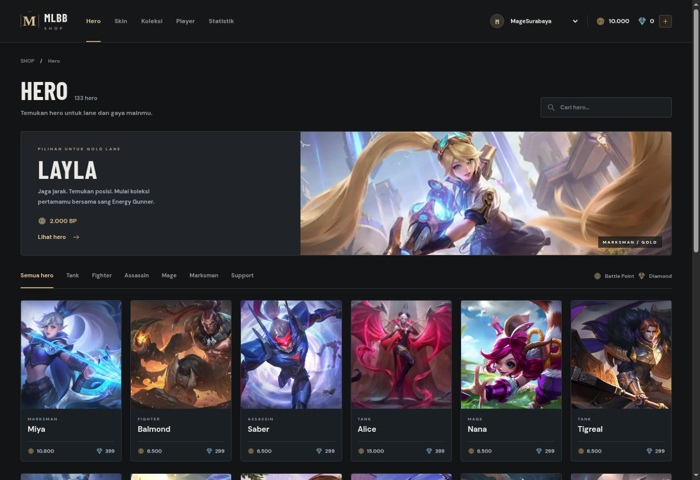
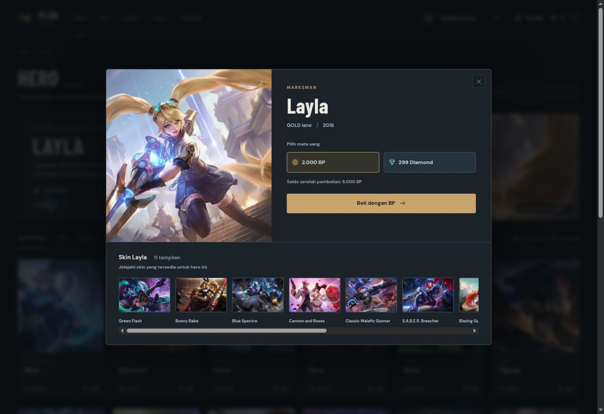
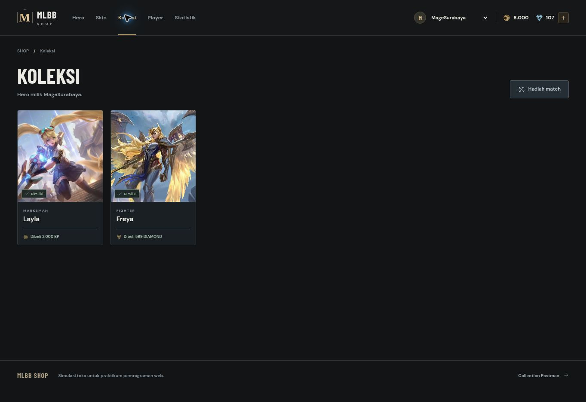
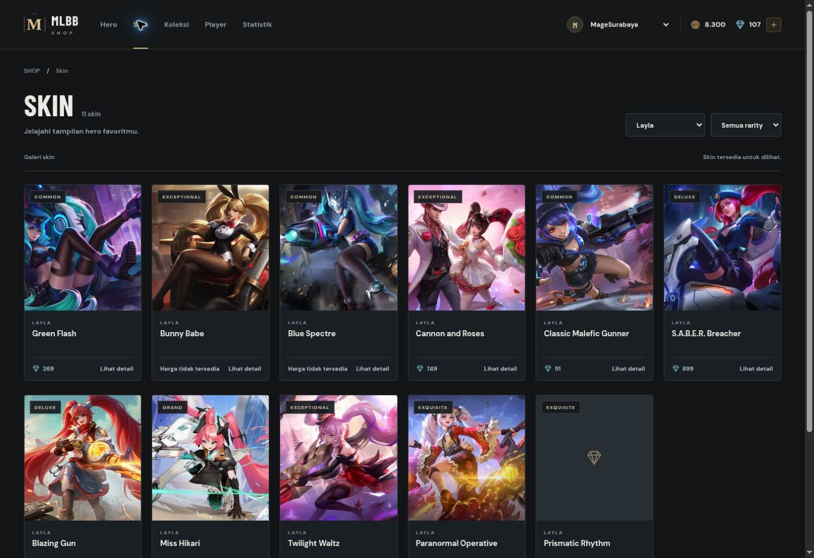
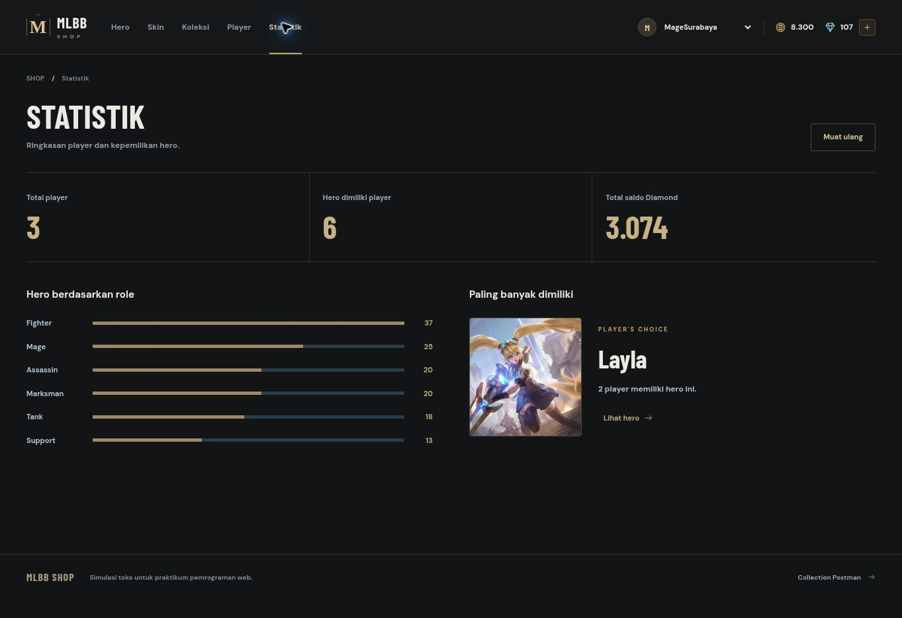

# Laporan Praktikum Modul 4 — MLBB Shop

**Pemrograman Website 2026 · Kelompok B03**

| Identitas proyek | Keterangan |
| --- | --- |
| Kelompok | B03 |
| Aplikasi | MLBB Shop |
| Backend | Express 5, TypeScript, Prisma 7 |
| Database tugas | PostgreSQL pada Neon melalui `@prisma/adapter-neon` |
| Mode latihan | PostgreSQL lokal berbasis PGlite |
| Dasar dokumentasi | Source pada branch `main`, commit `cebb598`, 5 November 2026 |

## Daftar isi

1. [Gambaran umum dan tujuan](#1-gambaran-umum-dan-tujuan)
2. [Fitur dan cakupan aplikasi](#2-fitur-dan-cakupan-aplikasi)
3. [Teknologi yang digunakan](#3-teknologi-yang-digunakan)
4. [Arsitektur dan struktur program](#4-arsitektur-dan-struktur-program)
5. [Perancangan database](#5-perancangan-database)
6. [Dataset dan proses seed](#6-dataset-dan-proses-seed)
7. [Instalasi dan cara menjalankan](#7-instalasi-dan-cara-menjalankan)
8. [Dokumentasi endpoint API](#8-dokumentasi-endpoint-api)
9. [Aturan bisnis dan transaksi pembelian](#9-aturan-bisnis-dan-transaksi-pembelian)
10. [Statistik dan pengolahan data](#10-statistik-dan-pengolahan-data)
11. [Pengujian Postman di VS Code](#11-pengujian-postman-di-vs-code)
12. [Perhitungan saldo selama pengujian](#12-perhitungan-saldo-selama-pengujian)
13. [Dokumentasi tampilan aplikasi](#13-dokumentasi-tampilan-aplikasi)
14. [Panduan presentasi dan rekaman demo](#14-panduan-presentasi-dan-rekaman-demo)
15. [Command pemeriksaan](#15-command-pemeriksaan)
16. [Catatan hasil pengujian](#16-catatan-hasil-pengujian)
17. [Penanganan kendala](#17-penanganan-kendala)
18. [Kesimpulan](#18-kesimpulan)

## 1. Gambaran umum dan tujuan

MLBB Shop merupakan aplikasi praktikum untuk mengelola katalog hero dan skin Mobile Legends: Bang Bang serta mensimulasikan pembelian hero oleh player. Backend menyediakan REST API, sedangkan frontend menampilkan data dan menjalankan operasi melalui API yang sama.

Pengembangan berfokus pada pemodelan relasi database, pengolahan data menggunakan Prisma, validasi request, penanganan error, dan transaksi pembelian yang menjaga konsistensi saldo serta kepemilikan hero.

Tujuan praktikum meliputi:

1. Membangun API dengan Express dan TypeScript.
2. Menghubungkan Prisma ke PostgreSQL Neon menggunakan adapter Neon.
3. Menyusun model, relasi, enum, migrasi, dan seed database.
4. Menyediakan katalog dengan pagination, pencarian, filter, dan detail relasi.
5. Mengimplementasikan pengelolaan player, penambahan saldo, hadiah match, dan pembelian hero.
6. Menggunakan transaksi database untuk menggabungkan debit saldo dan pencatatan kepemilikan.
7. Menyajikan statistik menggunakan `count`, `aggregate`, dan `groupBy`.
8. Menguji perilaku berhasil maupun gagal melalui collection Postman.

Top up dan hadiah match merupakan simulasi perubahan saldo pada database praktikum. Pemilihan player dilakukan melalui dropdown; autentikasi dan JWT tidak diterapkan sesuai cakupan tugas.

## 2. Fitur dan cakupan aplikasi

| Bagian | Implementasi |
| --- | --- |
| Hero | Daftar, pagination, pencarian nama, filter role, detail beserta skin, dan penambahan hero |
| Skin | Daftar, pagination, filter hero/rarity, serta detail beserta hero terkait |
| Player | Membuat player, melihat detail/koleksi, mengubah nickname, dan menghapus player |
| Diamond | Top up dengan jumlah bilangan bulat positif |
| Match | Hadiah `WIN` sebesar 300 BP dan `LOSE` sebesar 100 BP |
| Pembelian | Memilih BP atau Diamond, memeriksa syarat pembelian, lalu menjalankan transaksi |
| Koleksi | Menampilkan hero, mata uang, dan harga yang dibayar ketika pembelian |
| Statistik | Jumlah player, total kepemilikan, total Diamond, hero terpopuler, dan jumlah hero per role |
| Middleware | Logger, validasi, penanganan endpoint tidak dikenal, dan error handler |
| Frontend | Katalog, detail hero/skin, dompet player, top up, hadiah match, pengelolaan player, dan statistik |
| Operasional | Peluncur otomatis, log startup, penyimpanan data lokal, dan pemilihan port saat port awal dipakai |

Galeri skin menyediakan informasi dan tampilan skin. Objek pembelian pada implementasi tugas ini adalah **hero**.

## 3. Teknologi yang digunakan

Versi berikut mengacu pada `package.json` dan konfigurasi proyek.

| Teknologi | Versi/acuan | Fungsi |
| --- | --- | --- |
| Node.js | Seri 24 direkomendasikan | Menjalankan aplikasi dan script |
| Express | 5.1.0 | HTTP server, routing, middleware, dan static frontend |
| TypeScript | 5.9.3 | Pemeriksaan tipe dan kompilasi |
| Prisma CLI / Prisma Client | 7.10.1 | Schema, migrasi, generate client, dan query database |
| `@prisma/adapter-neon` | 7.10.1 | Adapter koneksi PostgreSQL Neon |
| `@neondatabase/serverless` | 1.2.0 | Transport database Neon |
| Zod | 4.6.7 | Validasi body, enum, dan parameter |
| dotenv | 17.2.3 | Membaca konfigurasi `.env` |
| ws | 8.22.1 | Implementasi WebSocket pada Node.js |
| PGlite / pglite-socket | 0.5.12 / 0.2.15 | PostgreSQL WASM dan koneksi pada mode lokal/pengujian |
| tsx | 4.20.6 | Menjalankan source TypeScript |
| HTML, CSS, JavaScript | Native | Antarmuka dan komunikasi melalui Fetch API |
| Postman / Newman | Collection v2.1 | Pengujian request dan assertion API |

Peluncur mendukung Node.js seri 22 mulai 22.12 serta seri 24 ke atas. Node.js 24 digunakan sebagai acuan pemasangan.

## 4. Arsitektur dan struktur program

### 4.1 Alur aplikasi



Mode dipilih saat peluncuran. `npm start` memakai database lokal, sedangkan `npm run start:neon` memakai koneksi Neon. Data pada kedua mode tersimpan terpisah. Pada mode lokal, proxy WebSocket terikat pada `127.0.0.1`; proses Neon menggunakan konfigurasi koneksi cloud tersendiri.

### 4.2 Pembagian tanggung jawab file

| Lokasi | Tanggung jawab |
| --- | --- |
| `src/index.ts` | Entry server dengan database Neon |
| `src/local.ts` | Entry lokal, penguncian database, seed awal, dan reset lokal |
| `src/app.ts` | JSON parser, logger, health check, routing API, frontend, dan error handler |
| `src/routes/api.routes.ts` | Pemetaan method HTTP ke controller |
| `src/controllers/catalog.controller.ts` | Katalog hero dan skin |
| `src/controllers/player.controller.ts` | Pengelolaan player, top up, match, dan response pembelian |
| `src/controllers/statistics.controller.ts` | Perhitungan statistik |
| `src/services/player.service.ts` | Pemeriksaan player, penambahan saldo, dan transaksi pembelian |
| `src/lib/validation.ts` | Zod schema, parameter ID, query, dan metadata pagination |
| `src/lib/database.ts` | Pembuatan Prisma Client dengan PrismaNeon |
| `src/lib/local-database.ts` | PostgreSQL lokal, penerapan SQL migrasi, dan persistensi |
| `src/lib/local-lock.ts` | Mencegah proses lokal menulis database yang sama bersamaan |
| `src/lib/serve.ts` | HTTP server, perpindahan port, pembaruan collection, dan shutdown |
| `src/lib/seed-data.ts` | Implementasi pengisian ulang dataset dan player awal |
| `src/lib/collection.ts` | Pembuatan collection Postman beserta assertion |
| `src/middleware/` | Logger, `HttpError`, `notFound`, dan `errorHandler` |
| `prisma/schema.prisma` | Model, enum, constraint, dan relasi |
| `prisma/migrations/` | SQL migrasi awal |
| `prisma/seed.ts` | Entry seed untuk Neon melalui Prisma CLI |
| `prisma.config.ts` | Konfigurasi Prisma 7 dan URL direct untuk migrasi |
| `data/` | Dataset JSON serta CSV sumber |
| `public/` | Frontend, ikon, artwork, dan font |
| `postman/` | Collection asli dan collection dengan assertion |
| `tests/` | Test API, startup, dan konfigurasi |
| `docs/test-results/` | Catatan hasil pengujian yang disertakan |
| `screenshots/` | Dokumentasi tampilan aplikasi |

## 5. Perancangan database

Database memiliki empat model utama: `Hero`, `Skin`, `Player`, dan `PlayerHero`. Tabel `PlayerHero` menjadi penghubung relasi banyak-ke-banyak antara player dan hero, sekaligus menyimpan informasi pembelian.

### 5.1 Entity relationship diagram



### 5.2 Kamus data

| Model | Field | Tipe Prisma | Ketentuan dan makna |
| --- | --- | --- | --- |
| Hero | `id` | Int | Primary key, autoincrement |
| Hero | `name` | String | Nama hero, unik |
| Hero | `role` | Role | Role utama |
| Hero | `lane` | Lane | Lane utama |
| Hero | `releaseYear` | Int | Tahun rilis |
| Hero | `priceBP` | Int? | Harga BP; boleh null |
| Hero | `priceDiamond` | Int? | Harga Diamond; boleh null |
| Skin | `id` | Int | Primary key, autoincrement |
| Skin | `name` | String | Nama skin |
| Skin | `rarity` | Rarity | Kategori rarity |
| Skin | `priceDiamond` | Int? | Informasi harga; boleh null |
| Skin | `heroId` | Int | Foreign key ke Hero |
| Player | `id` | Int | Primary key, autoincrement |
| Player | `nickname` | String | Nickname unik |
| Player | `bp` | Int | Default 10000 |
| Player | `diamond` | Int | Default 0 |
| Player | `createdAt` | DateTime | Waktu pembuatan, default now |
| PlayerHero | `id` | Int | Primary key, autoincrement |
| PlayerHero | `playerId` | Int | Foreign key ke Player |
| PlayerHero | `heroId` | Int | Foreign key ke Hero |
| PlayerHero | `currency` | Currency | Mata uang ketika pembelian |
| PlayerHero | `pricePaid` | Int | Harga yang benar-benar dibayar |

`skins`, `players`, `heroes`, `hero`, dan `player` pada schema merupakan field relasi Prisma. Field tersebut memungkinkan pengambilan data terkait melalui `include` atau `select`.

### 5.3 Enum

| Enum | Nilai yang digunakan |
| --- | --- |
| Role | TANK, FIGHTER, ASSASSIN, MAGE, MARKSMAN, SUPPORT |
| Lane | EXP, GOLD, MID, JUNGLE, ROAM |
| Rarity | COMMON, EXCEPTIONAL, DELUXE, EXQUISITE, GRAND, SUPREME |
| Currency | BP, DIAMOND |

### 5.4 Constraint dan relasi

1. `Hero.name` dan `Player.nickname` memiliki unique constraint.
2. Kombinasi `PlayerHero.playerId` dan `PlayerHero.heroId` dibuat unik melalui `@@unique([playerId, heroId])`.
3. Penghapusan Hero melakukan cascade pada Skin terkait.
4. Penghapusan Player melakukan cascade pada PlayerHero terkait.
5. Relasi PlayerHero ke Hero memakai `ON DELETE RESTRICT` pada migrasi. Hero yang masih direferensikan kepemilikan tidak langsung dapat dihapus.
6. `pricePaid` menyimpan harga historis pembelian; nilainya terpisah dari harga katalog saat ini.

Endpoint penghapusan hero tidak disediakan. Aturan cascade dan restrict tersebut berada pada schema/database.

## 6. Dataset dan proses seed

### 6.1 Dataset

Dataset berasal dari tautan penugasan yang dicatat pada [dokumentasi aset](docs/ASSETS.md). Arsip sumber berisi CSV. Data dikonversi menjadi JSON dengan angka bertipe number dan harga kosong menjadi null. Urutan data dipertahankan agar ID yang digunakan collection sesuai.

| Berkas | Isi |
| --- | --- |
| `data/source/heroes.csv` | CSV hero sumber |
| `data/source/skins.csv` | CSV skin sumber |
| `data/heroes.json` | 133 hero |
| `data/skins.json` | 892 skin |

Seed memetakan `primaryRole` menjadi `Hero.role` dan `primaryLane` menjadi `Hero.lane`. Kolom yang dimasukkan ke database mengikuti model tugas.

| Acuan dataset | Nilai |
| --- | --- |
| Miya | Hero id 1 |
| Layla | Hero id 18, 2000 BP, 299 Diamond |
| Freya | Hero id 22, priceBP null, 599 Diamond |
| Gusion | Hero id 56 |
| Ling | Hero id 84 |
| Hirara | Hero id 133 |
| Hero role MARKSMAN | 20 |
| Nama hero mengandung `la` | 10 |
| Skin Layla | 11 |
| Skin rarity GRAND | 98 |
| Skin id 891 | Silverbolt Raiko, hero Selena |

Distribusi role awal adalah Fighter 37, Mage 25, Assassin 20, Marksman 20, Tank 18, dan Support 13, dengan total 133 hero.

### 6.2 Player dan kepemilikan awal

| ID | Nickname | BP | Diamond | Hero yang sudah dimiliki |
| ---: | --- | ---: | ---: | --- |
| 1 | ArekITS | 1500 | 75 | Layla, Miya |
| 2 | SangPushRank | 13000 | 2892 | Ling, Gusion |
| 3 | MageSurabaya | 10000 | 0 | Belum ada |

| Player | Hero | Currency | Price paid |
| --- | --- | --- | ---: |
| ArekITS | Layla, id 18 | BP | 2000 |
| ArekITS | Miya, id 1 | BP | 10800 |
| SangPushRank | Ling, id 84 | DIAMOND | 599 |
| SangPushRank | Gusion, id 56 | BP | 32000 |

Player baru yang dibuat melalui API memperoleh default schema 10000 BP dan 0 Diamond. Saldo player seed mengikuti nilai khusus pada tabel di atas.

### 6.3 Mekanisme seed

Implementasi terdapat pada `src/lib/seed-data.ts`, dipanggil melalui `prisma/seed-data.ts` dan entry yang sesuai.

1. Membaca JSON dan memeriksa jumlah serta urutan ID.
2. Menjalankan `TRUNCATE "PlayerHero", "Player", "Skin", "Hero" RESTART IDENTITY CASCADE` dalam transaksi.
3. Mengisi hero dengan `createMany` tanpa memberikan ID secara manual.
4. Mengisi skin, tiga player, dan empat kepemilikan awal.

`RESTART IDENTITY` mengembalikan penomoran ID agar sesuai dengan collection. Pemanggilan seed/reset menghapus isi keempat tabel MLBB pada database sasaran. Startup normal hanya melakukan seed otomatis ketika tabel Hero, Skin, dan Player seluruhnya kosong; data yang sudah ada dipertahankan.

## 7. Instalasi dan cara menjalankan

### 7.1 Prasyarat

- Node.js 24 dan npm.
- Git untuk clone repository, atau hasil ekstraksi seluruh ZIP source.
- Internet untuk pemasangan dependency pertama dan koneksi Neon.
- Akun Neon untuk menjalankan mode cloud sesuai tugas.
- VS Code dengan extension Postman untuk mengikuti collection.

Periksa runtime:

```powershell
node -v
npm.cmd -v
```

Clone repository:

```powershell
git clone https://github.com/ndrrr1/pweb-express-B03-2026.git
cd pweb-express-B03-2026
```

Pada terminal selain PowerShell, `npm.cmd` dapat ditulis sebagai `npm`.

### 7.2 Mode demo lokal

Jalankan dari folder yang berisi `package.json`:

```powershell
npm.cmd start
```

Alternatif Windows: klik dua kali `JALANKAN.cmd` setelah seluruh source diekstrak.

Peluncur memeriksa runtime dan file proyek, memasang dependency dari lockfile jika diperlukan, menjalankan `prisma generate`, membuat database lokal, menerapkan SQL migrasi, mengisi seed awal, kemudian menyalakan web/API.

Contoh alamat dengan port default:

| Layanan | Alamat |
| --- | --- |
| Website | `http://localhost:3000` |
| Health check | `http://localhost:3000/health` |
| Collection port aktif | `http://localhost:3000/postman/collection.json` |

Gunakan alamat yang benar-benar tercetak pada terminal. Ketika port awal digunakan, server mencoba port berikutnya. File collection di folder Postman diperbarui mengikuti port aktif.

Mode lokal tidak memerlukan `.env` atau PostgreSQL terpisah. Data disimpan pada `.local-db`, sedangkan pengunci proses mencegah dua server dari folder yang sama menulis data secara bersamaan. Hentikan server dengan Ctrl+C agar proses penutupan database selesai.

### 7.3 Mode Neon untuk pelaksanaan tugas

Hentikan server lokal sebelum berpindah mode, lalu jalankan:

```powershell
npm.cmd run start:neon
```

Alternatif Windows: `JALANKAN-NEON.cmd`.

Pada setup pertama:

1. Buka Neon Console dan pilih project khusus tugas.
2. Pada **Connect**, pilih branch, database, dan role yang akan dipakai.
3. Aktifkan **Connection pooling**, salin URL lengkap, lalu tempel ketika diminta.
4. Untuk koneksi direct, tempel URL dengan pooling OFF pada branch/database/role yang sama. Setup juga menerima Enter untuk membentuk URL direct dari URL pooling tadi.
5. Tunggu generate, `prisma migrate deploy`, dan pemeriksaan seed selesai.
6. Setelah muncul **MLBB SHOP SIAP — NEON**, buka alamat Website.

Setup menerima URL biasa atau salinan perintah `psql 'postgresql://...'` dan menyimpan URL yang sudah dinormalisasi. Mode Neon tetap membutuhkan kredensial akun yang valid.

Jika konfigurasi diisi manual, salin `.env.example` menjadi `.env`, lalu lengkapi:

```dotenv
DATABASE_URL=
DATABASE_URL_UNPOOLED=
PORT=3000
```

| Variabel | Penggunaan |
| --- | --- |
| DATABASE_URL | URL pooled untuk PrismaNeon saat aplikasi berjalan |
| DATABASE_URL_UNPOOLED | URL direct untuk Prisma Migrate |
| PORT | Port HTTP; default 3000 |

Kredensial disimpan pada `.env` yang telah dicakup `.gitignore`. File `.env.example` hanya menyediakan nama variabel. Tampilkan source dan hasil request saat demo dengan menjaga password database tetap tersembunyi.

### 7.4 Memeriksa mode aktif

Contoh format response `/health` pada mode lokal:

```json
{
  "status": true,
  "message": "MLBB Shop API berjalan",
  "data": {
    "service": "mlbb-shop",
    "database": "connected",
    "mode": "local"
  }
}
```

Pada mode cloud, nilai `data.mode` adalah `neon`. Health check menjalankan `SELECT 1`, sehingga respons sukses sekaligus memeriksa akses query database. Footer juga menampilkan mode aktif. Gunakan mode Neon ketika mendemonstrasikan syarat database cloud.

### 7.5 Ringkasan perintah

| Kebutuhan | Lokal | Neon |
| --- | --- | --- |
| Mulai dengan persiapan otomatis | `npm start` | `npm run start:neon` |
| Persiapan tanpa menyalakan server | `npm run setup:local` | `npm run setup` |
| Pengembangan dengan watch | `npm run dev` | `npm run dev:neon` |
| Reset data demo | `npm run demo:reset` | `npm run demo:reset:neon` |
| Menjalankan hasil kompilasi | `npm run start:build` | `npm run start:build:neon` |

Jalankan persiapan terlebih dahulu sebelum memakai perintah watch. Perintah `check:env`, `db:migrate`, `db:deploy`, `db:seed`, dan `db:studio` menggunakan konfigurasi Neon. Pilihan database untuk reset ditentukan oleh perintah: `demo:reset` selalu lokal, sedangkan `demo:reset:neon` menjalankan seed pada Neon aktif.

## 8. Dokumentasi endpoint API

Base URL contoh adalah `http://localhost:3000`. Sesuaikan dengan port pada terminal.

### 8.1 Daftar endpoint

| No. | Method | Endpoint | Input/parameter | Fungsi |
| ---: | --- | --- | --- | --- |
| 1 | GET | `/health` | — | Memeriksa server, database, dan mode |
| 2 | GET | `/api/heroes` | page, limit, search, role | Daftar hero |
| 3 | GET | `/api/heroes/:hero_id` | ID hero | Detail hero beserta seluruh skin |
| 4 | POST | `/api/heroes` | name, role, lane, releaseYear, harga | Membuat hero |
| 5 | GET | `/api/skins` | page, limit, heroId, rarity | Daftar skin beserta nama hero |
| 6 | GET | `/api/skins/:skin_id` | ID skin | Detail skin beserta data hero |
| 7 | POST | `/api/players` | nickname | Membuat player |
| 8 | GET | `/api/players/:player_id` | ID player | Detail player dan koleksi |
| 9 | PATCH | `/api/players/:player_id` | nickname | Mengubah nickname |
| 10 | DELETE | `/api/players/:player_id` | ID player | Menghapus player dan kepemilikannya |
| 11 | POST | `/api/players/:player_id/topup` | amount | Menambah Diamond |
| 12 | POST | `/api/players/:player_id/matches` | result | Memberikan BP hasil match |
| 13 | POST | `/api/players/:player_id/heroes` | heroId, currency | Membeli hero |
| 14 | GET | `/api/statistics` | — | Mengambil statistik toko |

Endpoint tambahan `GET /api/players` dipakai untuk daftar dan pemilih player di frontend. Route `GET /postman/collection.json` menyediakan file impor sesuai port aktif.

### 8.2 Bentuk response dan HTTP status

Response sukses memakai `status`, `message`, dan `data`. Endpoint daftar dengan pagination menambahkan `metadata`. Response gagal memakai `status: false` dan `message`.

| HTTP status | Makna |
| ---: | --- |
| 200 | Request berhasil; termasuk update, top up, match, dan delete |
| 201 | Hero/player berhasil dibuat atau hero berhasil dibeli |
| 400 | Input tidak valid, mata uang tidak tersedia, atau saldo tidak cukup |
| 404 | Data atau endpoint tidak ditemukan |
| 409 | Nama/nickname duplikat atau hero sudah dimiliki |
| 413 | Body request melewati batas 64 KB |
| 500 | Kesalahan server yang tidak termasuk error terkelola |

Contoh error pembelian Freya dengan BP:

```json
{
  "status": false,
  "message": "Hero Freya tidak bisa dibeli dengan BP"
}
```

### 8.3 Pagination, pencarian, dan filter

| Query | Berlaku pada | Ketentuan |
| --- | --- | --- |
| page | Hero dan skin | Bilangan bulat positif; default 1 |
| limit | Hero dan skin | Bilangan bulat positif; default 10; maksimal 100 |
| search | Hero | Pencarian sebagian nama, case-insensitive |
| role | Hero | Salah satu enum Role, huruf kapital |
| heroId | Skin | ID hero berupa bilangan bulat positif |
| rarity | Skin | Salah satu enum Rarity, huruf kapital |

Pagination menghitung `skip = (page - 1) * limit`. Query jumlah data menggunakan filter yang sama dengan query daftar. `totalPages` dihitung dengan `Math.ceil(totalItems / limit)`.

Contoh request:

```http
GET /api/heroes?role=MARKSMAN&limit=5
GET /api/heroes?search=la
GET /api/skins?heroId=18
GET /api/skins?rarity=GRAND
```

Contoh response `GET /api/heroes?limit=1` pada seed awal:

```json
{
  "status": true,
  "message": "Berhasil mengambil data hero",
  "data": [
    {
      "id": 1,
      "name": "Miya",
      "role": "MARKSMAN",
      "lane": "GOLD",
      "releaseYear": 2016,
      "priceBP": 10800,
      "priceDiamond": 399
    }
  ],
  "metadata": {
    "currentPage": 1,
    "limit": 1,
    "totalItems": 133,
    "totalPages": 133
  }
}
```

### 8.4 Contoh body request

Gunakan **Body → raw → JSON** di Postman dan header `Content-Type: application/json` untuk request ber-body.

**Membuat hero — `POST /api/heroes`:**

```json
{
  "name": "Collie",
  "role": "MAGE",
  "lane": "MID",
  "releaseYear": 2026,
  "priceBP": 32000,
  "priceDiamond": 599
}
```

**Membuat player — `POST /api/players`:**

```json
{
  "nickname": "JunglerMalam"
}
```

**Mengubah nickname — `PATCH /api/players/3`:**

```json
{
  "nickname": "MageITS"
}
```

**Top up — `POST /api/players/3/topup`:**

```json
{
  "amount": 706
}
```

**Hadiah match — `POST /api/players/3/matches`:**

```json
{
  "result": "WIN"
}
```

**Membeli hero — `POST /api/players/3/heroes`:**

```json
{
  "heroId": 22,
  "currency": "DIAMOND"
}
```

### 8.5 Validasi input

- Nama hero wajib diisi setelah trim, maksimal 80 karakter; nickname maksimal 60 karakter.
- `releaseYear` berupa bilangan bulat antara 1 dan 9999.
- Harga berupa bilangan bulat nonnegatif atau null. Harga yang tidak diberikan disimpan sebagai null.
- `amount` harus bertipe number, bilangan bulat, lebih dari 0, dan tidak melebihi 2147483647.
- `heroId` dan ID pada path berupa bilangan bulat positif.
- Currency hanya `BP` atau `DIAMOND`; hasil match hanya `WIN` atau `LOSE`.
- Object body memakai schema strict sehingga field tambahan yang tidak dikenal ditolak.
- Penambahan saldo diperiksa agar tidak melampaui batas Int PostgreSQL.

Angka dalam body harus dikirim sebagai number, misalnya `706`, bukan string `"706"`.

## 9. Aturan bisnis dan transaksi pembelian

### 9.1 Saldo dan hadiah

Top up menggunakan operasi `increment` pada field Diamond. Match WIN menambah 300 BP dan LOSE menambah 100 BP. Penambahan dilakukan pada database agar operasi memakai nilai saldo yang tersimpan saat update berlangsung.

### 9.2 Urutan pemeriksaan pembelian

| Urutan | Pemeriksaan | Hasil jika tidak memenuhi |
| ---: | --- | --- |
| 1 | Body sesuai schema dan ID memiliki format valid | 400 |
| 2 | Player tersedia | 404 |
| 3 | Hero tersedia | 404 |
| 4 | Harga untuk currency yang dipilih tidak null | 400 |
| 5 | Player belum memiliki hero | 409 |
| 6 | Saldo mencukupi harga | 400 |
| 7 | Debit saldo dan pencatatan kepemilikan berhasil | 201 |

Harga null berarti hero tidak tersedia untuk dibeli menggunakan mata uang tersebut. Freya memiliki `priceBP: null`, sehingga pembelian dengan BP ditolak.

Urutan kepemilikan sebelum saldo membuat pembelian ulang Layla menghasilkan 409 walaupun saldo Diamond player saat itu juga lebih kecil daripada harga Layla.

### 9.3 Array transaction

Bagian inti `buyHero` pada `src/services/player.service.ts` menjalankan dua query dalam satu transaksi:

```typescript
const [updated] = await db.$transaction([
  db.player.update({
    where: { id: playerId, [balanceField]: { gte: price } },
    data: { [balanceField]: { decrement: price } },
  }),
  db.playerHero.create({
    data: { playerId, heroId, currency, pricePaid: price },
  }),
]);
```

`balanceField` berisi `bp` atau `diamond`. Debit dan pencatatan kepemilikan harus berhasil bersama. Jika query kepemilikan gagal, debit ikut dibatalkan oleh rollback transaksi.

Kondisi `gte: price` diperiksa kembali saat update di database. Unique constraint pasangan player/hero mencegah kepemilikan ganda. Implementasi menangani konflik pembelian serentak melalui kode Prisma `P2002` dan `P2025`, kemudian memetakan hasilnya menjadi response yang sesuai.

Contoh response sukses pembelian Freya pada request 18, setelah top up dan WIN:

```json
{
  "status": true,
  "message": "Hero berhasil dibeli",
  "data": {
    "hero": { "id": 22, "name": "Freya" },
    "currency": "DIAMOND",
    "pricePaid": 599,
    "balance": { "bp": 10300, "diamond": 107 }
  }
}
```

### 9.4 Middleware dan penanganan error

| Komponen | Perilaku |
| --- | --- |
| Logger | Mencatat method, URL, status response, dan durasi setelah request selesai |
| JSON parser | Membatasi body 64 KB dan mendeteksi JSON rusak |
| HttpError | Membawa status HTTP dan pesan untuk kegagalan bisnis |
| ZodError | Diubah menjadi HTTP 400 dengan pesan validasi |
| notFound | Menangani endpoint yang tidak tersedia |
| errorHandler | Menyeragamkan response error dan menangani kesalahan tak terduga |

Parser dan logger dipasang sebelum router; `notFound` dan `errorHandler` diletakkan setelah route. Express 5 meneruskan penolakan async handler ke middleware error. Header `X-Content-Type-Options: nosniff` juga dipasang dan header `X-Powered-By` dinonaktifkan.

## 10. Statistik dan pengolahan data

Endpoint `GET /api/statistics` menjalankan beberapa query dan menyatukan hasilnya.

| Field response | Perhitungan |
| --- | --- |
| totalPlayers | `player.count()` |
| totalHeroesOwned | `playerHero.count()` |
| totalDiamond | `player.aggregate({ _sum: { diamond: true } })` |
| mostOwnedHero | `playerHero.groupBy` berdasarkan heroId, urutkan jumlah pemilik terbesar |
| heroesPerRole | `hero.groupBy` berdasarkan role dan hitung jumlah hero |

`totalHeroesOwned` menghitung baris kepemilikan, sehingga hero yang sama milik dua player dihitung dua kali. `heroesPerRole` menghitung katalog hero. Jika jumlah pemilik sama, pemilihan hero terpopuler diurutkan lagi berdasarkan heroId terkecil. Jika tidak ada kepemilikan, `mostOwnedHero` bernilai null.

Contoh response pada request 25 setelah collection dijalankan satu putaran dari seed:

```json
{
  "status": true,
  "message": "Berhasil mengambil statistik",
  "data": {
    "totalPlayers": 4,
    "totalHeroesOwned": 6,
    "totalDiamond": 3074,
    "mostOwnedHero": { "heroId": 18, "name": "Layla", "owners": 2 },
    "heroesPerRole": [
      { "role": "FIGHTER", "total": 37 },
      { "role": "MAGE", "total": 26 },
      { "role": "ASSASSIN", "total": 20 },
      { "role": "MARKSMAN", "total": 20 },
      { "role": "TANK", "total": 18 },
      { "role": "SUPPORT", "total": 13 }
    ]
  }
}
```

Jumlah Mage menjadi 26 karena request 06 menambahkan Collie. Jumlah seluruh katalog pada tahap ini adalah 134 hero.

## 11. Pengujian Postman di VS Code

### 11.1 Persiapan data

Selesaikan pemasangan awal terlebih dahulu. Hentikan server dengan Ctrl+C, lalu pilih reset sesuai mode.

Untuk latihan lokal:

```powershell
npm.cmd run demo:reset
npm.cmd start
```

Untuk demo dengan Neon:

```powershell
npm.cmd run demo:reset:neon
npm.cmd run start:neon
```

Reset mengembalikan database sasaran ke seed awal. Sesudah reset, kirim setiap request tepat satu kali dan berurutan. Aktivitas pembelian/top up melalui website juga mengubah data, sehingga demo frontend dilakukan setelah urutan Postman atau pada sesi yang sudah di-reset kembali.

### 11.2 Impor collection

1. Buka VS Code dan extension Postman, lalu masuk ke workspace.
2. Tekan **Ctrl+Shift+P → Postman: Import → File**, atau pilih Import pada sidebar Postman.
3. Pilih `postman/MLBB-Shop-28-Testcase.postman_collection.json`.
4. Buka collection **MLBB Shop - 28 Testcase Teruji**.
5. Kirim request 01 sampai 28 dan lihat bagian Test Results.

Collection memakai URL serta ID literal, tanpa variabel yang harus diisi. Jika port berubah, ambil collection terbaru dari footer **Collection Postman** atau route `/postman/collection.json`. File impor berformat JSON collection; dataset, `.env`, dan ZIP bukan file collection.

Collection asli tersimpan pada `postman/mlbb-shop-testcase.original.json`. Collection teruji mempertahankan method, path, query, dan body, lalu menambahkan assertion status HTTP serta isi response. Terdapat dua assertion per request, dengan total 56.

### 11.3 Urutan lengkap 28 testcase

| No. | Method dan endpoint | Skenario/input utama | Hasil yang diharapkan |
| ---: | --- | --- | --- |
| 01 | GET `/health` | Health check | 200; database connected; mode sesuai peluncuran |
| 02 | GET `/api/heroes?role=MARKSMAN&limit=5` | Filter Marksman | 200; totalItems 20; maksimal 5 data pada halaman |
| 03 | GET `/api/heroes?search=la` | Pencarian nama | 200; totalItems 10 |
| 04 | GET `/api/heroes/18` | Detail Layla | 200; 11 skin |
| 05 | GET `/api/heroes/999` | Hero tidak ada | 404 |
| 06 | POST `/api/heroes` | Membuat Collie, MAGE/MID | 201; id 134 |
| 07 | POST `/api/heroes` | Nama Collie lagi | 409 |
| 08 | POST `/api/heroes` | Hanya name Kaiden | 400 |
| 09 | GET `/api/skins?heroId=18` | Skin Layla | 200; totalItems 11; default pagination tetap berlaku |
| 10 | GET `/api/skins?rarity=GRAND` | Filter rarity | 200; totalItems 98 |
| 11 | GET `/api/skins/891` | Silverbolt Raiko | 200; hero Selena |
| 12 | POST `/api/players` | Nickname JunglerMalam | 201; id 4, BP 10000, Diamond 0 |
| 13 | POST `/api/players` | Nickname ArekITS | 409 |
| 14 | POST `/api/players/3/topup` | amount 706 | 200; Diamond 706 |
| 15 | POST `/api/players/3/topup` | amount -10 | 400; saldo tetap |
| 16 | POST `/api/players/3/matches` | result WIN | 200; bertambah 300 BP, menjadi 10300 |
| 17 | POST `/api/players/3/heroes` | Freya id 22, BP | 400; harga BP null |
| 18 | POST `/api/players/3/heroes` | Freya id 22, DIAMOND | 201; membayar 599, Diamond tersisa 107 |
| 19 | POST `/api/players/3/heroes` | Layla id 18, BP | 201; membayar 2000, BP tersisa 8300 |
| 20 | POST `/api/players/3/heroes` | Layla lagi, DIAMOND | 409; sudah dimiliki |
| 21 | POST `/api/players/1/heroes` | Hirara id 133, BP | 400; saldo ArekITS tidak mencukupi |
| 22 | GET `/api/players/3` | Detail koleksi | 200; Freya dan Layla beserta currency/pricePaid |
| 23 | PATCH `/api/players/3` | Nickname MageITS | 200 |
| 24 | PATCH `/api/players/3` | Nickname ArekITS | 409; nickname sudah dipakai |
| 25 | GET `/api/statistics` | Statistik sebelum delete | 200; 4 player, 6 kepemilikan, 3074 Diamond; Layla 2 pemilik |
| 26 | DELETE `/api/players/4` | Menghapus JunglerMalam | 200 |
| 27 | GET `/api/players/4` | Detail player yang dihapus | 404 |
| 28 | GET `/api/ngawur` | Endpoint tidak tersedia | 404 |

HTTP 400, 404, dan 409 pada skenario negatif merupakan hasil pengujian yang diharapkan. Seluruh urutan harus dimulai dari seed agar ID serta saldo sesuai tabel.

## 12. Perhitungan saldo selama pengujian

### 12.1 Saldo player 3

| Tahap | Perubahan BP | Saldo BP | Perubahan Diamond | Saldo Diamond |
| --- | ---: | ---: | ---: | ---: |
| Seed MageSurabaya | — | 10000 | — | 0 |
| Top up 706 | 0 | 10000 | +706 | 706 |
| Top up negatif ditolak | 0 | 10000 | 0 | 706 |
| WIN | +300 | 10300 | 0 | 706 |
| Freya dengan BP ditolak | 0 | 10300 | 0 | 706 |
| Membeli Freya dengan Diamond | 0 | 10300 | -599 | 107 |
| Membeli Layla dengan BP | -2000 | 8300 | 0 | 107 |
| Membeli ulang Layla ditolak | 0 | 8300 | 0 | 107 |
| Mengubah nickname | 0 | 8300 | 0 | 107 |

Perhitungan akhirnya adalah `10000 + 300 - 2000 = 8300 BP` dan `0 + 706 - 599 = 107 Diamond`.

### 12.2 Statistik pada request 25

| Komponen | Perhitungan | Hasil |
| --- | --- | ---: |
| Jumlah player | 3 player seed + JunglerMalam | 4 |
| Jumlah kepemilikan | 4 kepemilikan seed + Freya + Layla | 6 |
| Total Diamond | ArekITS 75 + SangPushRank 2892 + MageITS 107 + JunglerMalam 0 | 3074 |
| Pemilik Layla | ArekITS + MageITS | 2 |
| Jumlah katalog hero | 133 seed + Collie | 134 |

Sesudah request 26, jumlah player menjadi 3. Kepemilikan tetap 6 karena JunglerMalam tidak membeli hero, dan total Diamond tetap 3074 karena saldo Diamond player tersebut 0.

Beberapa gambar contoh pada modul berasal dari request yang diulang. Angka pada laporan ini mengikuti seed dan satu putaran collection, sehingga top up menghasilkan 706 dan WIN menghasilkan BP 10300 sebelum pembelian.

## 13. Dokumentasi tampilan aplikasi

Lima screenshot berikut tersimpan pada repository dan diambil dari aplikasi yang berjalan pada database lokal/pengujian tanggal 4 November 2026. Sesi frontend ini terpisah dari urutan Postman: katalog tetap 133 hero dan terdapat tiga player. Versi 1.1 mempertahankan desain tersebut serta menambahkan keterangan mode pada footer.

### 13.1 Katalog hero



Halaman Hero menampilkan katalog, pencarian nama, filter role, harga BP/Diamond, dan pagination. Pemilih player serta saldo berada pada header.

### 13.2 Detail dan harga hero



Dialog Layla menampilkan role, lane, tahun rilis, pilihan mata uang, perkiraan saldo setelah pembelian, dan galeri skin terkait. Tombol pembelian menjalankan endpoint API.

### 13.3 Koleksi hasil pembelian



Layla dibeli seharga 2000 BP dan Freya 599 Diamond setelah top up 706. Gambar ini diambil **sebelum** hadiah WIN, sehingga saldo BP masih 8000 dan Diamond 107. Koleksi menyimpan currency dan harga ketika pembelian.

### 13.4 Filter skin Layla



Filter hero menghasilkan total 11 skin Layla. Pada tahap ini hadiah WIN sudah diterima sehingga BP menjadi 8300. Skin tanpa artwork yang cocok tetap menampilkan data katalog.

### 13.5 Statistik toko



Sesi frontend memperlihatkan tiga player, enam kepemilikan, total 3074 Diamond, dan Layla dimiliki dua player. Distribusi role memakai katalog 133 hero, sehingga Mage berjumlah 25 pada gambar. Pada urutan Postman, penambahan Collie membuat Mage menjadi 26.

Screenshot frontend mendokumentasikan perilaku antarmuka dan perubahan data lokal. Bukti koneksi cloud B03 diperoleh dengan menjalankan mode Neon dan memeriksa `/health` pada akun kelompok.

## 14. Panduan presentasi dan rekaman demo

Untuk memperlihatkan pemenuhan tugas Neon, jalankan mode Neon pada database khusus tugas. Isi konfigurasi sebelum merekam, lakukan reset, dan buka collection yang sesuai port aktif.

| Tahap | Yang ditampilkan | Penjelasan utama |
| ---: | --- | --- |
| 1 | Repository dan package.json | Identitas B03, tujuan MLBB Shop, dan stack yang digunakan |
| 2 | prisma/schema.prisma | Empat model, enum, default saldo, foreign key, dan unique constraint |
| 3 | src/lib/seed-data.ts dan dataset | 133 hero, 892 skin, tiga player, empat kepemilikan; TRUNCATE dan createMany |
| 4 | Request 01–11 | Health mode Neon, pencarian/filter/pagination, detail relasi, create hero, dan validasi |
| 5 | Request 12–16 | Player baru, nickname unik, top up, amount negatif, dan hadiah match |
| 6 | Request 17–21 dan player.service.ts | Urutan pemeriksaan pembelian dan array transaction |
| 7 | Request 22–25 | Koleksi, perubahan nickname, count, aggregate, dan groupBy |
| 8 | Request 26–28 | Delete, 404 setelah delete, serta notFound untuk endpoint asing |
| 9 | Website | Katalog, detail, koleksi, skin, top up/match, player, dan statistik |
| 10 | Test Results dan log | Assertion sesuai skenario dan konsistensi hasil |

Pada penjelasan transaksi, tunjukkan bahwa dua query merupakan satu kesatuan: saldo dikurangi dan PlayerHero dibuat. Saat request gagal, saldo serta kepemilikan harus tetap konsisten. Jelaskan juga bahwa 400/404/409 yang direncanakan adalah bukti penanganan kondisi gagal.

Untuk rekaman satu alur, selesaikan Postman dahulu, kemudian tampilkan website. Jika ingin mendemokan pembelian dari kondisi awal melalui website, reset kembali database yang dipilih, lalu jalankan urutan: pilih MageSurabaya → beli Layla dengan BP → top up 706 → beli Freya dengan Diamond → ambil hadiah WIN. Saldo akhirnya 8300 BP dan 107 Diamond.

## 15. Command pemeriksaan

### 15.1 Pemeriksaan source dan pengujian otomatis

Jalankan setelah dependency tersedia. `setup:local` membuat Prisma Client tanpa menyalakan server.

```powershell
npm.cmd run setup:local
npm.cmd run data:verify
npm.cmd test
npm.cmd run test:env
npm.cmd run typecheck
npm.cmd run build
```

| Command | Yang diperiksa |
| --- | --- |
| data:verify | Jumlah data, urutan ID, dan nilai acuan dataset |
| npm test | API dan startup; database pengujian terisolasi |
| test:env | Validasi serta normalisasi konfigurasi Neon |
| test:startup | Startup, persistensi setelah restart, reset, pengunci, dan port |
| typecheck | Konsistensi tipe TypeScript tanpa menghasilkan dist |
| build | Kompilasi source menjadi dist |

Test otomatis menggunakan database pengujian dan tidak memakai kredensial Neon kelompok.

### 15.2 Pemeriksaan API dari PowerShell

Biarkan server berjalan pada terminal pertama. Pada terminal kedua, sesuaikan `$base` dengan alamat server aktif:

```powershell
$base = "http://localhost:3000"
Invoke-RestMethod "$base/health" | ConvertTo-Json -Depth 10
Invoke-RestMethod "$base/api/heroes?role=MARKSMAN&limit=5" | ConvertTo-Json -Depth 10
Invoke-RestMethod "$base/api/heroes/18" | ConvertTo-Json -Depth 10
Invoke-RestMethod "$base/api/skins?heroId=18" | ConvertTo-Json -Depth 10
Invoke-RestMethod "$base/api/players/3" | ConvertTo-Json -Depth 10
Invoke-RestMethod "$base/api/statistics" | ConvertTo-Json -Depth 10
```

Command tersebut membaca data. Nilai statistik bergantung pada transaksi yang sudah dijalankan pada database aktif.

### 15.3 Pemeriksaan Prisma untuk Neon

```powershell
npm.cmd run check:env
npm.cmd exec -- prisma migrate status
npm.cmd run db:generate
npm.cmd run db:studio
```

`migrate status` memeriksa status migrasi pada koneksi Neon. `db:studio` membuka antarmuka data. Migrasi baru selama pengembangan dapat dibuat dengan `npm run db:migrate -- --name nama_perubahan`; setup biasa memakai migrasi yang sudah disertakan melalui `db:deploy`.

### 15.4 Query SQL pemeriksaan data

Query berikut dapat dijalankan pada SQL Editor Neon untuk database yang sedang didemokan:

```sql
SELECT COUNT(*) AS total_hero FROM "Hero";
SELECT COUNT(*) AS total_skin FROM "Skin";
SELECT COUNT(*) AS total_player FROM "Player";
SELECT COUNT(*) AS total_kepemilikan FROM "PlayerHero";

SELECT id, nickname, bp, diamond
FROM "Player"
ORDER BY id;

SELECT p.nickname, h.name AS hero, ph.currency, ph."pricePaid"
FROM "PlayerHero" ph
JOIN "Player" p ON p.id = ph."playerId"
JOIN "Hero" h ON h.id = ph."heroId"
ORDER BY ph.id;

SELECT role, COUNT(*) AS jumlah
FROM "Hero"
GROUP BY role
ORDER BY jumlah DESC, role;

SELECT COALESCE(SUM(diamond), 0) AS total_diamond
FROM "Player";
```

## 16. Catatan hasil pengujian

Repository menyertakan catatan pengujian tanggal **5 November 2026** menggunakan Node.js 24.22.1 dan npm 11.9.0 pada Linux. Ringkasan berikut merujuk pada berkas bukti yang sudah tersedia.

| Pemeriksaan | Hasil tercatat | Bukti |
| --- | --- | --- |
| API dan startup | 41 lulus, 0 gagal | [api-tests.txt](docs/test-results/api-tests.txt) |
| Konfigurasi Neon | 9 lulus, 0 gagal | [environment-tests.txt](docs/test-results/environment-tests.txt) |
| Collection pada entry server | 28 request, 56 assertion, 0 gagal | [startup-report.json](docs/test-results/startup-report.json) |
| Instalasi bersih dan restart | Berhasil; transaksi dipertahankan | [startup-run.txt](docs/test-results/startup-run.txt) |
| Runtime hasil kompilasi | Berhasil | [startup-report.json](docs/test-results/startup-report.json) |
| Audit dependency produksi | 0 temuan pada pemeriksaan tersebut | [audit-production.json](docs/test-results/audit-production.json) |

Test tambahan mencakup input/parameter tidak valid, prioritas pemeriksaan, hadiah LOSE, rollback pembelian gagal, dua pembelian bersamaan, pencegahan saldo negatif, cascade, JSON rusak, startup tanpa `.env`, persistensi, pengunci, dan perpindahan port.

Catatan startup memakai folder baru tanpa node_modules, Prisma Client, dist, `.env`, atau database bawaan. Peluncur memasang dependency, melakukan generate, menerapkan schema, mengisi seed, dan menjalankan aplikasi sebelum collection diuji.

Pengujian database tersebut memakai PostgreSQL WASM dan PrismaNeon melalui proxy lokal. Catatan yang disertakan belum membuktikan koneksi Neon kelompok atau eksekusi file CMD pada Windows fisik. Verifikasi cloud dilakukan pada mode Neon menggunakan kredensial kelompok. Penjelasan lingkungan lengkap ada pada [HASIL-PENGUJIAN.md](docs/HASIL-PENGUJIAN.md).

## 17. Penanganan kendala

| Gejala | Penjelasan dan langkah |
| --- | --- |
| node/npm tidak ditemukan | Pasang Node.js 24, lalu buka ulang terminal |
| npm.ps1 diblokir PowerShell | Gunakan npm.cmd pada command yang sama |
| Peluncur menyatakan file proyek tidak lengkap | Ekstrak seluruh source dan jalankan dari folder berisi package.json |
| Client Prisma belum tersedia | Gunakan peluncur npm start/setup:local atau jalankan db:generate setelah dependency terpasang |
| Cannot find module setelah instalasi terputus | Jalankan npm ci, lalu mulai ulang peluncur |
| check:env menolak URL kosong | Perintah tersebut memeriksa Neon; lokal dapat dijalankan melalui npm start |
| P1000 pada Neon | Salin kembali URL lengkap dengan role/password yang berlaku dari Connect |
| P1001/timeout pada Neon | Periksa koneksi internet dan endpoint project, lalu ulangi setup |
| Port 3000 dipakai | Gunakan port baru yang dicetak pada terminal dan collection yang diperbarui |
| Server lokal pada folder yang sama masih berjalan | Gunakan terminal lama atau hentikan dengan Ctrl+C sebelum memulai lagi |
| Impor Postman gagal | Pilih file JSON collection, bukan ZIP/dataset/.env; pastikan source sudah diekstrak |
| Collie/JunglerMalam menghasilkan 409 pada pengulangan | Data sudah dibuat; reset mode yang dipakai sebelum mengulang seluruh collection |
| Pembelian Freya dengan BP menghasilkan 400 | Sesuai aturan priceBP null |
| Pembelian ulang menghasilkan 409 | Hero sudah dimiliki player |
| GET player setelah DELETE menghasilkan 404 | Player sudah terhapus sesuai skenario |
| Jumlah skin di halaman pertama kurang dari totalItems | Pagination membatasi isi halaman; lihat metadata atau lanjutkan halaman |
| Artwork skin tertentu belum tampil | Sebagian artwork dimuat daring; data katalog tetap tersedia |

Peluncur menyimpan pesan terbaru pada `logs/startup.log`. File tersebut membantu menelusuri tahapan yang gagal. `.env`, node_modules, dist, `.local-db`, `.cache`, dan log runtime telah dicakup pola pengabaian pada `.gitignore`.

## 18. Kesimpulan

MLBB Shop mengimplementasikan katalog berelasi, pengelolaan player, penambahan saldo, hadiah match, pembelian hero, dan statistik melalui Express, TypeScript, serta Prisma. Schema menjaga keunikan dan hubungan data, sedangkan array transaction menggabungkan pengurangan saldo dengan pencatatan kepemilikan.

Frontend memperlihatkan perubahan melalui API yang sama dengan collection Postman. Mode lokal menyediakan lingkungan latihan dengan data persisten; mode Neon digunakan untuk menjalankan syarat PostgreSQL cloud pada tugas. Catatan pengujian yang disertakan menunjukkan perilaku API, transaksi, dan startup pada lingkungan pengujian lokal.
